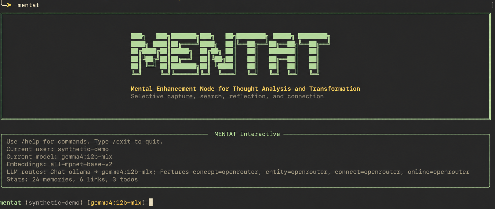
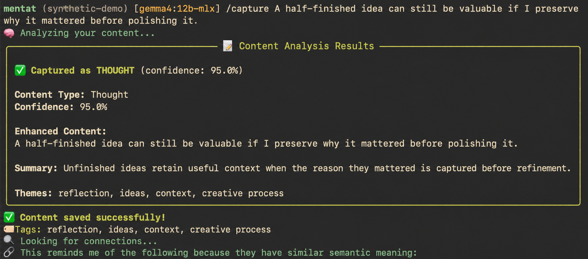
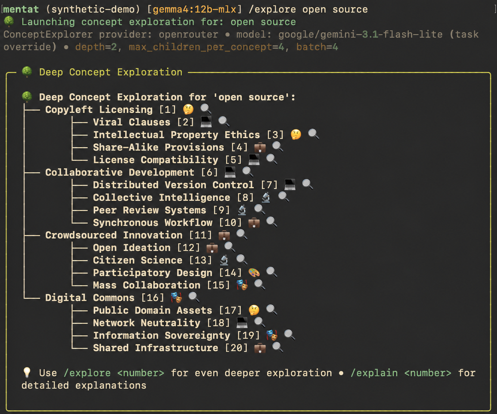
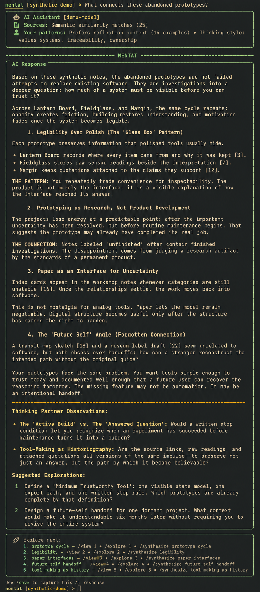

# Mentat In Action

Mentat is a local-first memory system that runs in the terminal. These examples use synthetic content and a neutral demo identity.

## Start With A Local Workspace

Mentat shows the active user, local embedding model, model routes, and collection size when an interactive session begins.

## Capture A Thought

Capture preserves the original idea while adding a concise summary, themes, tags, and semantic connections.

## Explore A Concept

Concept exploration builds a navigable tree of related ideas that can be expanded or explained individually.

## Synthesize Across Memories

Mentat retrieves related memories and uses them to identify recurring patterns, connections, and promising next questions.

